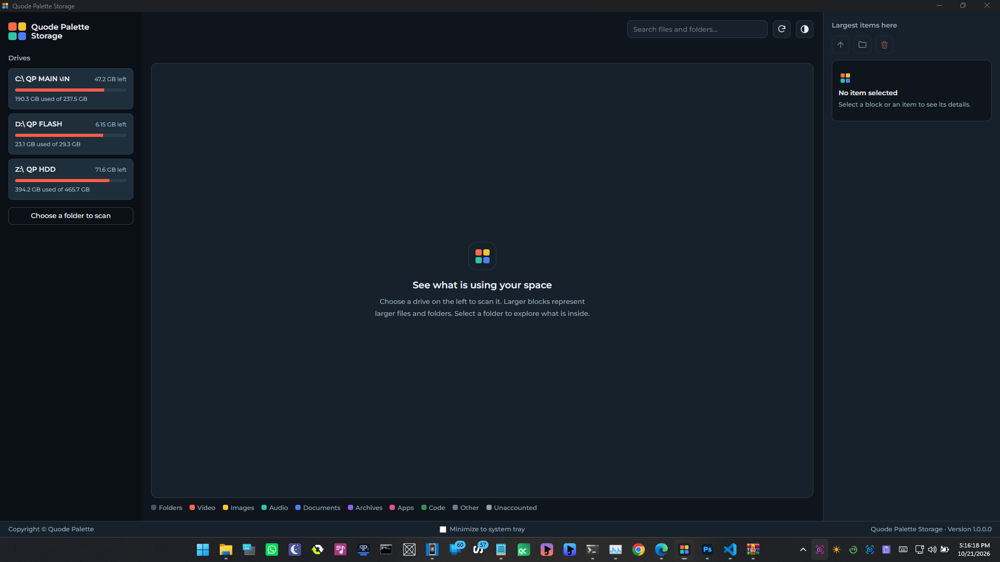
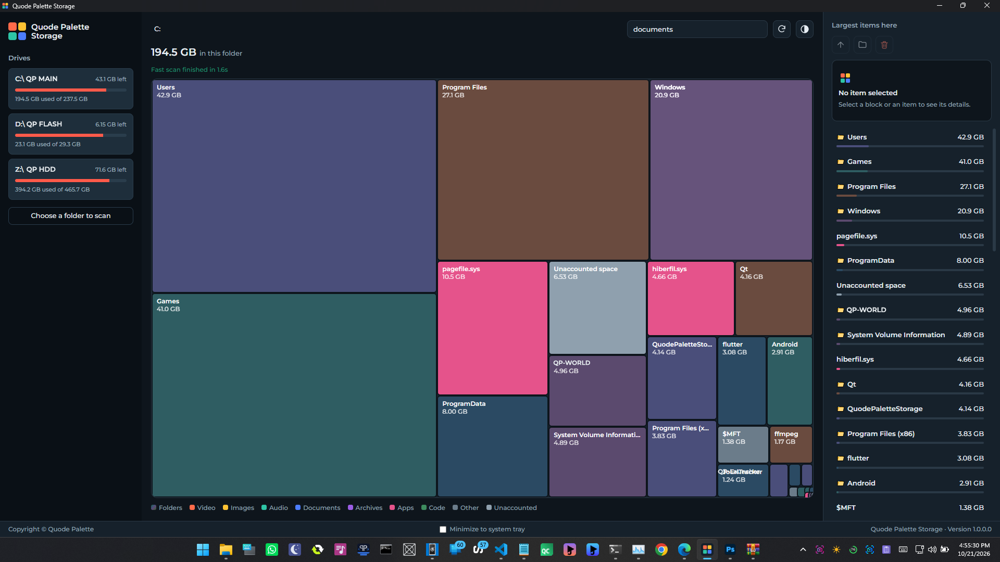
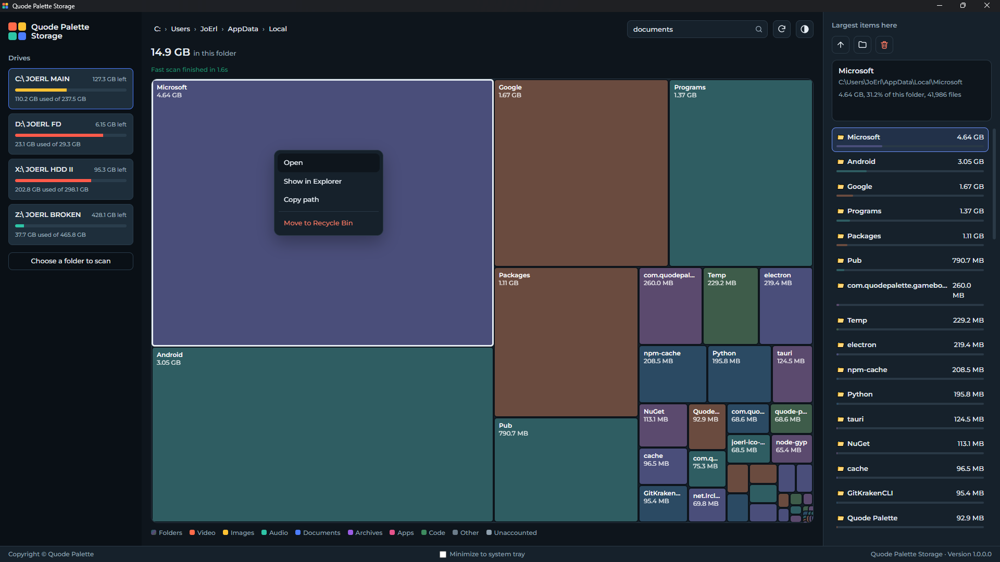
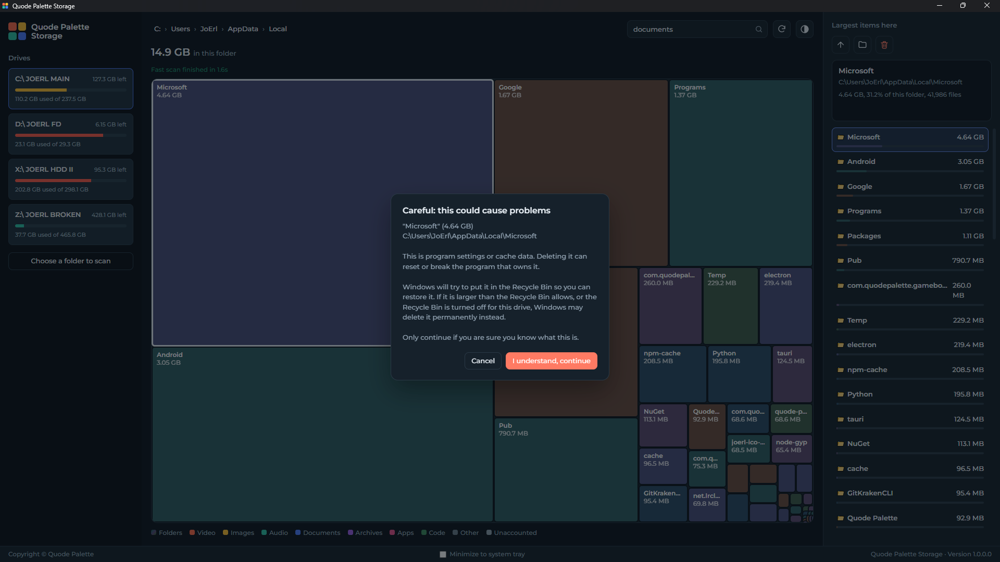
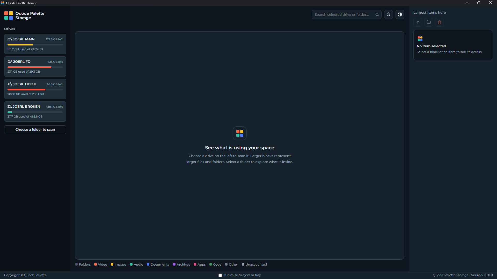

# Quode Palette Storage

See what is hogging your disk space.

Quode Palette Storage scans a drive and shows everything as a colorful map. Bigger blocks mean bigger files and folders, so the space hogs stand out right away. Click a folder to look inside, and clean up what you do not need.

  
  <b>Screenshot I</b>

<table>
    <td width="50%" align="center">
      
       
      <b>Screenshot II</b>
       
      <!-- Convert common audio formats with FFmpeg -->
    </td>
    <td width="50%" align="center">
      
       
      <b>Screenshot III</b>
       
      <!-- Convert common video formats with FFmpeg -->
    </td>
</table>
<table>
    <td width="50%" align="center">
      
       
      <b>Screenshot IV</b>
       
      <!-- Convert common audio formats with FFmpeg -->
    </td>
    <td width="50%" align="center">
      
       
      <b>Screenshot V</b>
       
      <!-- Convert common video formats with FFmpeg -->
    </td>
</table>

## What it does

- Scans a whole drive or any folder you pick
- Shows a block map of your files, plus a list of the largest items in the current folder
- Searches the drive or folder you selected
- Moves unwanted files and folders to the Recycle Bin
- Can empty the Recycle Bin of a drive
- Light and dark mode
- Optional minimize to the system tray

## Fast scanning

On NTFS drives the app reads the file table directly, which is why a full drive scan finishes so quickly. This needs administrator rights, so Windows will ask for permission when you open the app. If a drive cannot be scanned this way, the app falls back to a normal folder scan.

## Safe cleanup

Deleting things from a disk tool should never be scary, so the app has some guardrails:

- Everything goes to the Recycle Bin, not straight into the void
- Windows system folders, user profile folders and important system files are blocked
- Program files, app data and similar items show a stronger warning before you can continue
- Network and removable drives have no Recycle Bin, and the app tells you when a delete would be permanent

## Download

Grab the latest version from the [Releases](../../releases) page. Each release has the installer and the standalone exe, so pick whichever you prefer.

## Requirements

- Windows 10 or 11 (64 bit)
- Administrator rights for the fast NTFS scan

## Notes

- The app only reads your drives and, when you ask it to, moves items to the Recycle Bin. It does not send any data anywhere.
- The Montserrat fonts in `ui/fonts` are under the SIL Open Font License (see `OFL.txt`).

## License

[PolyForm Noncommercial License 1.0.0](LICENSE)

Copyright © Quode Palette
